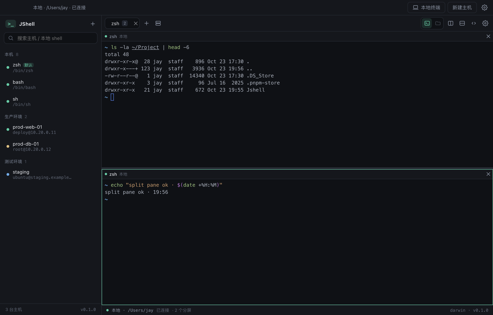
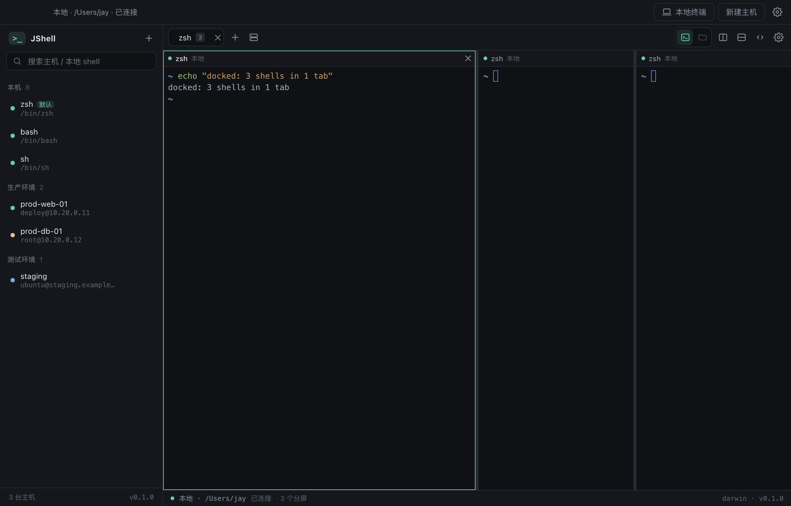
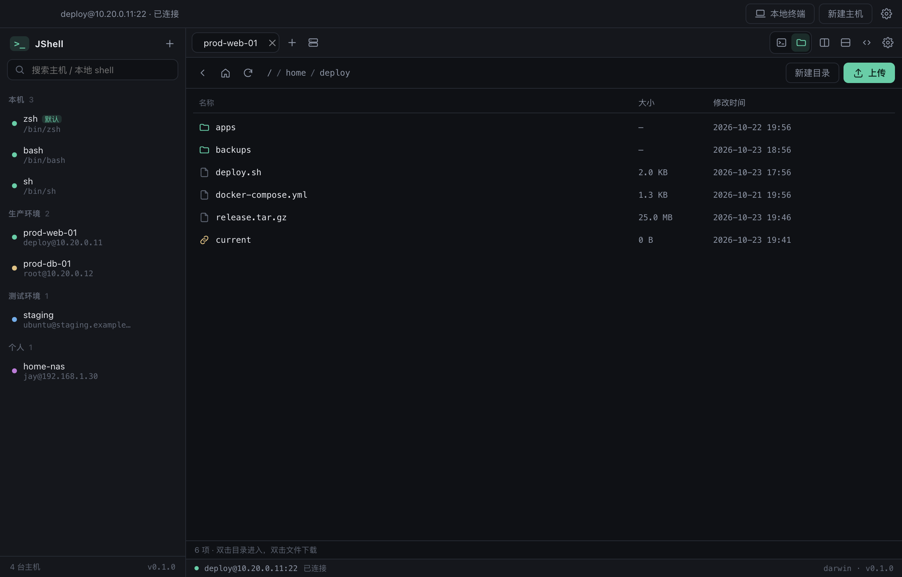
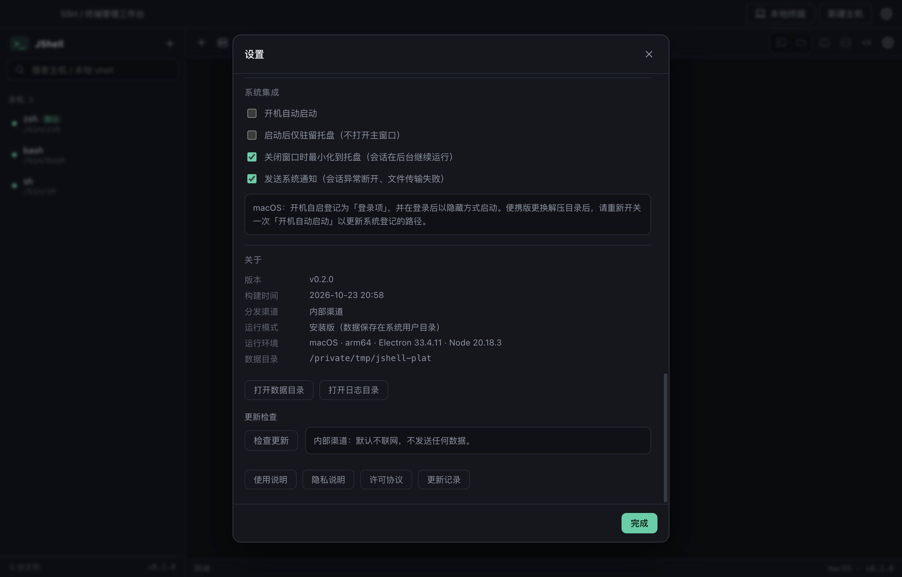

# JShell

跨平台 SSH / 终端管理工作台。纯本地运行，无账号体系、无云端依赖。

> **macOS 与 Windows 同等支持**：路径、权限、托盘、系统通知、开机自启行为一致，两个平台都产出安装版与便携版。
> 界面、菜单、安装向导、日志与错误提示**只有简体中文**；默认不采集、不上报任何数据。



## 界面

| 分屏终端（本地 zsh × 2） | 拖拽吸附（3 个终端 → 1 个标签） |
| --- | --- |
|  |  |

| 远端文件（SFTP） | 系统集成与关于 |
| --- | --- |
|  |  |

## 特性

- **本地终端**：自动识别系统 shell（macOS/Linux 读 `/etc/shells` → zsh/bash/fish/sh；Windows → cmd / Windows PowerShell / PowerShell 7），点击即开，无需配置
- **SSH 连接管理**：主机 / 端口 / 用户名 / 密码 · 私钥 · ssh-agent 三种认证，分组与搜索
- **分屏**：左右 / 上下分割，可嵌套、可拖拽调整比例；每个分屏独立 PTY，切换不丢历史
- **拖拽吸附**：把标签拖到任意分屏的左/右/上/下边缘，即可把整个终端并进来（3 个终端合成 1 个标签）
- **布局记忆**：退出前的标签与分屏结构会在下次启动时恢复（只还原结构，不自动重连）
- **多标签会话**：`⌘/Ctrl + 1..9` 快速切换，中键关闭
- **快捷键可改**：所有动作都能在设置里重新录制绑定，冲突会高亮提示
- **终端内核**：xterm.js（VS Code 同款），256 色 / 真彩色、`vim`、`htop`、`tmux` 备用屏幕、缩放重排
- **终端搜索**：`⌘/Ctrl + F` 增量搜索，高亮匹配、显示 `当前/总数`、Enter/⇧Enter 跳转
- **右键菜单**：复制 / 粘贴 / 全选 / 搜索 / 清屏 / 分屏 / 关闭，全部可鼠标完成
- **文件面板**：远端 SFTP 与本地文件双面板；地址栏粘贴路径直达（`⌘/Ctrl + L`）；上传/下载、目录上传、多选下载、取消传输、重命名、回收站删除；传输先写临时文件再原子替换，失败不破坏目标文件
- **常驻目录树**：放在左侧栏、主机列表下方，跟随当前选中的终端（多标签/多分屏自动切换），高度可拖拽；双击文本文件直接编辑
- **文件传输**：标题栏「文件传输」随时可用（全局工具，不绑定会话）；向导式三步配置，支持本机上传 / 下载 / 服务器间中转，实时进度与速度、失败重试、断点续传
- **本机终端管理**：侧边栏每个 shell 可单独隐藏，设置里可批量恢复；只留常用的 zsh 也不会再占空间
- **内置编辑器**：双击文本文件直接在应用内打开并保存，无需远端 vim/nano；二进制与超过 2 MB 的文件会提示改用下载
- **连接测试**：新建 / 编辑主机时可先「测试连接」，校验地址、端口、账号与口令后再保存
- **本地持久化**：主机、设置、命令片段、分屏布局存本地 JSON；密码 / 私钥口令经系统安全存储（Keychain / DPAPI / libsecret）加密
- **主机指纹**：按 `host:port:算法` 记录，指纹变更时弹窗对比新旧 SHA256，可一键信任并重连
- **主题**：深色 / 浅色 / 跟随系统 + 6 套终端配色，字号、字体、回滚行数即时生效
- **命令片段**：常用命令一键发送到当前会话
- **跳板机**：主机可指定另一台主机作为单跳跳板（复用同一套认证与指纹校验）
- **配置迁移与同步**：导出加密同步包（`scrypt` + `AES-256-GCM`），可放任意文件夹、iCloud / OneDrive / Dropbox / 坚果云，或经剪贴板传递；
  导入前逐条检测「新增 / 覆盖 / 删除」并标出风险项；选定位置后可开启自动同步（本机改动写回、远端改动拉取，遇到风险默认暂停），位置支持本地/云盘目录、SFTP 自有服务器或 WebDAV；
  删除只影响本机、不跨设备传播（配置搬运的定位，不做墓碑同步）；
  支持旧 `jshell` 数据目录自动迁移
- **托盘常驻**：菜单栏 / 任务栏托盘菜单（显示窗口、新建终端、新建主机、设置、检查更新、打开日志、退出）
- **系统集成**：开机自启（macOS 登录项 / Windows 当前用户启动项）、启动仅驻留托盘、关闭窗口到托盘、系统通知
- **便携版**：macOS 解压即用 zip、Windows 单文件 portable exe，数据写在程序目录的 `JShell-Data`
- **全中文**：界面、菜单、安装向导、日志、错误提示、安装说明统一简体中文
- **分发扩展点**：未签名/自签名内部分发；代码签名、公证、更新通道、许可与隐私说明已预留
- **零上报**：没有任何埋点或统计；只有用户发起的 SSH/SFTP 与（公开渠道下）主动触发的更新检查会联网
- **预留接口**：端口转发（本地 `-L` 的后端与 IPC 已就绪，界面尚未接线）

## 快速开始

```bash
npm install          # 安装依赖（下载 Electron 二进制 + node-pty 预编译产物）
npm run dev          # 开发模式，热更新
```

> `npm install` 的 postinstall 会自动给 node-pty 的 `spawn-helper` 补可执行位（缺失时会报 `posix_spawnp failed`）。

首次运行：点击「新建主机」→ 填写地址 / 端口 / 用户名 / 认证方式 → 保存 → 单击左侧主机即开新会话。

## 测试

```bash
npm test
```

用 Node 内置 runner 直接跑 TS 源码（`--experimental-strip-types`），**不引入 vitest/jest**。当前 **179 个用例**，覆盖：

- `pane-tree`：分屏增删、单分支折叠、比例夹取、深度优先顺序
- `pane-dock`：拖拽吸附的整标签 / 单分屏 / 嵌套 / 自引用判定
- `shortcuts`：归一化、macOS/Windows 修饰键映射、精确匹配、录制边界
- `paths`：`~` 与 `%USERPROFILE%` 展开、Windows 分隔符归一、空路径保护
- `version`：版本比较（含预发布版）、更新链接 https 白名单
- `utils`：字节格式化、远端/本地路径拼接与面包屑
- `settings`：设置校验与越界值夹取
- `layout-schema`：坏布局/超深嵌套的修复与丢弃
- `errors`：ssh2/SFTP/系统错误的中文映射
- `rsync`：进度行解析（2.6.9 与 3.x）、参数拼装、旧版参数降级
- `sftp`：上传/下载的临时文件 + 原子替换（**失败不破坏目标文件**）、名称校验
- `sync-crypto` / `sync-merge` / `sync-targets`：加解密往返、篡改检测、口令降级、稳定 id 合并、跳板机断链、指纹冲突、云盘探测
- `sync-diff` / `sync-auto`：覆盖前检测的四类变更与风险计数、自动同步的跳过/记账/应用/暂停决策、内容指纹防回声
- `webdav-transport`：用进程内假 WebDAV 跑通读写往返、口令错误、自检清理、轮询触发

## 一键打包

```bash
npm run dist:all                                       # 当前平台（安装版 + 便携版）
node scripts/build-all.mjs --mac --arch arm64,x64      # macOS 双架构
node scripts/build-all.mjs --win --arch x64            # Windows（原生环境或 CI）
node scripts/build-all.mjs --win --no-sign-edit        # 仅本地验证（图标/版本资源不写入，勿分发）
node scripts/build-all.mjs --win --docker              # 有 Docker 时用 wine 构建（产物元信息完整）
node scripts/build-all.mjs --dir                       # 只产出免安装目录（冒烟验证）
```

产物输出到 `release/<version>/`：

| 平台 | 安装版 | 便携版 |
| --- | --- | --- |
| macOS | `JShell-0.11.20-arm64.dmg` / `.zip`、`x64` 同名文件 | `JShell-0.11.20-<架构>-portable.zip`（解压即用） |
| Windows | `JShell-0.11.20-x64-setup.exe`（简体中文 NSIS 向导） | `JShell-0.11.20-x64-portable.exe`（单文件） |
| Linux | `JShell-0.11.20-x64.AppImage` / `.deb` | — |

### 发版（推 GitHub Release）

改完代码、升好版本号并补上 CHANGELOG 章节后：

```bash
node scripts/tag-release.mjs --dry-run   # 只校验：工作区干净 / CHANGELOG 有该版本 / tag 未占用
npm run release:tag                      # 打 tag v<版本> 并推送 main 与 tag
```

推送后 GitHub Actions 会在 macOS 与 Windows 原生环境各构建一次，
并**自动创建 Release**（正文是该版本的改动 + 下载对应包表格）。

两条通道的分工：

| 动作 | 结果 |
| --- | --- |
| `git push origin main` | 只跑构建，产物作为 Actions artifact（保留 90 天） |
| 打 tag `v<版本>` | 构建 + 创建 GitHub Release，安装包直接挂在 Release 上 |

> 忘记补 CHANGELOG 时脚本会直接拒绝——Release 正文由它生成，缺章节就没有说明可发。

分发、签名、更新通道与发布检查清单见 [docs/06-distribution.md](docs/06-distribution.md)。
跨平台实现细节与差异见 [docs/05-cross-platform.md](docs/05-cross-platform.md)。
内存与启动性能的测量方式、实测数据见 [docs/11-memory-and-performance.md](docs/11-memory-and-performance.md)。

> **Apple Silicon 用户请下载 `arm64` 包**。装成 `x64` 会走 Rosetta 转译，实测启动从 0.4 秒变成 8.8 秒；
> 应用启动时会自检并在日志中提示。Windows 包请在 Windows 或 CI 上构建——macOS 交叉打包会跳过 exe 资源写入，
> 图标与产品名会退回 Electron 默认值（见 [docs/Windows打包手册.md](docs/Windows打包手册.md)）。

> 内部渠道产物未签名：macOS 首次打开需右键 → 打开（或 `xattr -dr com.apple.quarantine`），
> Windows 需在 SmartScreen 中选「仍要运行」。
> 打 tag 后 CI 会在 macOS / Windows / Ubuntu 原生 runner 上并行构建并发布 Release。

## 快捷键

> 全部快捷键都能在「设置 → 快捷键」里点击后重新录制，下表是默认值。

| 快捷键 | 作用 |
| --- | --- |
| `⌘/Ctrl + T` | 新建本地终端 |
| `⌘/Ctrl + N` | 新建 SSH 主机 |
| `⌘/Ctrl + D` | 向右分屏 |
| `⌘/Ctrl + Shift + D` | 向下分屏 |
| `⌘/Ctrl + Shift + W` | 关闭当前分屏 |
| `⌘/Ctrl + Alt + ← / →` | 在分屏间切换 |
| `⌘/Ctrl + E` | 切换 终端 / 文件面板 |
| `⌘/Ctrl + L` | 聚焦文件面板地址栏（粘贴路径直达） |
| `⌘/Ctrl + F` | 在终端中搜索 |
| `⌘/Ctrl + W` | 关闭当前标签页（中键点击标签同样可关闭） |
| `⌘/Ctrl + Shift + T` | 重新打开最近关闭的标签（会话已结束则在原位静默重连） |
| `⌘/Ctrl + 1..9` | 切换到第 N 个标签（固定绑定） |
| `⌘/Ctrl + B` | 展开 / 收起命令片段 |
| `⌘/Ctrl + ,` | 打开设置 |
| `⌘C` / `⌘V`（macOS） | 终端内复制（需有选区）/ 粘贴 |
| `Ctrl + Shift + C / V`（Windows / Linux） | 终端内复制 / 粘贴（`Ctrl+C` 保留为中断信号） |

## 项目结构

```
.
├── electron.vite.config.ts     # 三段式构建（main / preload / renderer）
├── electron-builder.yml        # 三平台打包配置（含 node-pty asarUnpack）
├── scripts/
│   ├── build-all.mjs           # 一键打包（安装版 + 便携版 + 跨平台）
│   ├── make-release-meta.mjs   # 生成 release-meta.json（渠道 / 构建时间 / 更新地址）
│   ├── write-release-notes.mjs # 生成中文《安装说明》与 SHA256SUMS
│   └── fix-native-perms.mjs    # postinstall：修复 spawn-helper 可执行位
├── tests/                      # node --test 用例（.mjs，直接 import .ts）
├── build/                      # 应用图标、托盘图标、entitlements、公证钩子
├── src/
│   ├── shared/                 # 主进程与渲染进程共享的类型 / IPC 契约
│   │   ├── types.ts            # 领域模型（HostProfile / SessionEvent / ShellInfo ...）
│   │   ├── settings.ts         # 默认设置与配置校验
│   │   ├── layout-schema.ts    # 持久化布局的校验/修复
│   │   ├── errors.ts           # 第三方错误 -> 中文映射
│   │   ├── rsync.ts            # rsync 进度解析与参数拼装（纯函数，可单测）
│   │   ├── paths.ts            # 跨平台路径展开（~ / %VAR% / 分隔符）
│   │   ├── version.ts          # 版本比较与更新链接校验
│   │   ├── ipc.ts              # 通道常量
│   │   └── api.ts              # window.jshell 的类型定义
│   ├── main/                   # Electron 主进程（Node 侧）
│   │   ├── index.ts            # 窗口、菜单、生命周期
│   │   ├── ipc.ts              # 全部 IPC handler，唯一对外入口
│   │   └── services/
│   │       ├── types.ts        # TerminalSession 接口（SSH / 本地共用）
│   │       ├── session-manager.ts   # 会话索引，区分 SSH 与本地
│   │       ├── ssh-session.ts  # SSH 会话（握手 / PTY / 指纹校验）
│   │       ├── local-session.ts     # 本地终端（node-pty）
│   │       ├── shells.ts       # 系统 shell 自动探测
│   │       ├── output-buffer.ts     # 8ms / 64KB 输出聚合
│   │       ├── sftp.ts         # SFTP 列目录 / 传输 / 删除（支持取消）
│   │       ├── local-fs.ts     # 本地文件浏览 / 回收站删除
│   │       ├── rsync.ts        # rsync 任务：起进程 / 进度 / 重试 / 中转
│   │       ├── store.ts        # 本地 JSON 存储 + safeStorage 加密
│   │       ├── app-env.ts      # 便携版判定与数据目录
│   │       ├── tray.ts         # 托盘图标与中文菜单
│   │       ├── notifications.ts# 系统通知（聚焦静默 + 去重）
│   │       ├── login-item.ts   # 开机自启（登录项 / 启动项）
│   │       ├── logger.ts       # 本地中文日志（按天、5MB 轮转）
│   │       ├── update.ts       # 更新检查 Provider（内部渠道默认关闭）
│   │       ├── clipboard.ts    # 终端 Cmd+C/V 焦点分流
│   │       ├── tunnels.ts      # 端口转发（-L 已实现）
│   │       └── sync.ts         # rsync 同步接口预留
│   ├── preload/index.ts        # contextBridge 白名单 API
│   └── renderer/
│       └── src/
│           ├── App.tsx         # 三栏布局 + 快捷键分发
│           ├── store.ts        # zustand：标签 / 分屏树 / 设置
│           ├── pane-tree.ts    # 分屏树操作（增删叶子、折叠、比例）
│           ├── terminal-registry.ts  # xterm 实例常驻（DOM 可搬移）
│           ├── shortcuts.ts    # 快捷键目录 / 录制 / 匹配 / 格式化
│           ├── themes.ts       # 终端配色
│           ├── icons.tsx       # 手写图标集（零依赖）
│           └── components/     # PaneTree / TerminalView / FilesPanel / LocalFilesPanel / SettingsDialog ...
└── docs/
    ├── 01-tech-selection.md    # 技术选型对比与结论
    ├── 02-architecture.md      # 模块划分、数据流、IPC 契约、扩展点
    ├── 03-dependencies.md      # 依赖清单与许可
    ├── 04-audit-roadmap.md     # 代码审计：功能/性能/质量建议与执行顺序
    ├── 05-cross-platform.md    # macOS / Windows 一致性矩阵与差异
    ├── 06-distribution.md      # 内部分发、签名、更新通道与发布清单
    ├── 使用说明.md              # 随包分发的用户手册
    ├── privacy.md              # 隐私说明
    └── license.md              # 许可协议（MIT + 第三方组件）
```

## 数据存放位置

| 系统 | 路径 |
| --- | --- |
| macOS | `~/Library/Application Support/JShell/data/` |
| Windows | `%APPDATA%\JShell\data\` |
| Linux | `~/.config/JShell/data/` |
| 便携版（两平台） | 程序目录下的 `JShell-Data/data/` |

- `state.json`：主机配置、设置、命令片段、已知主机指纹（**不含明文口令**）
- `secrets.json`：加密后的密码 / passphrase（`safeStorage`）
- `layout.json`：上次退出时的标签 / 分屏结构（只存「怎么连」）
- `logs/`：中文运行日志，不含口令与终端输出

删除整个目录即完全重置，不残留任何云端数据。

## 安全模型

- 渲染进程 `contextIsolation: true`、`sandbox: true`、`nodeIntegration: false`，无 Node 能力
- 主进程只通过 `contextBridge` 暴露白名单方法，且**任何读取接口都不会回传已保存的密码**
- 主机公钥校验默认 **TOFU**：首次连接记录 SHA256 指纹（按 `host:port:算法`），指纹变化时弹窗确认
- 页面导航一律拦截，外链只允许 https 且交给系统浏览器；系统权限只放行剪贴板
- 传输先写临时文件再原子替换，失败不破坏目标文件
- **默认不采集任何数据**，详见 [docs/privacy.md](docs/privacy.md)

## 技术选型

详见 [docs/01-tech-selection.md](docs/01-tech-selection.md)。一句话结论：

> **Electron + TypeScript + React + xterm.js + ssh2 + node-pty** —— 用最成熟的终端内核与打包链路换取最低的长期维护成本。
> 本地终端使用 `node-pty`，其 1.1+ 提供 N-API 预编译产物，因此**仍然不需要**按 Electron ABI 重建（Linux 会在 install 时源码编译，CI 已具备工具链）。若未来需要 < 20 MB 包体，可按文档中的迁移路径换成 Tauri 壳，渲染层代码可复用约 90%。

## 路线图

> 逐项的「问题 → 方案 → 收益 → 成本」评估与排序见 [docs/04-audit-roadmap.md](docs/04-audit-roadmap.md)。

- [x] SSH 连接管理 / 多标签 / SFTP / 持久化 / 主题 / 命令片段
- [x] 本地终端（自动探测 shell）
- [x] 分屏（嵌套 + 拖拽调整比例）
- [x] 快捷键自定义（录制式绑定 + 冲突提示）
- [x] 拖拽吸附（标签 / 分屏拖到任意边缘即可并排）
- [x] 终端搜索、右键菜单、布局记忆、指纹变更确认
- [x] 托盘常驻、系统通知、开机自启、便携版、全中文界面
- [x] 分发扩展点（签名 / 公证 / 更新通道 / 许可与隐私）
- [x] 本地文件面板（浏览 / 增删改 / 回收站 / 系统定位）
- [x] 传输取消、多选下载、目录上传、单跳跳板机、配置导入导出、窗口位置记忆
- [x] 本地端口转发（后端）
- [ ] 端口转发管理 UI、远程 / 动态转发
- [ ] rsync / SFTP 差异同步（`src/main/services/sync.ts` 已定义接口）
- [ ] 会话录制与回放
- [ ] 自动下载安装更新（当前只做检查）
- [ ] 多跳跳板机 / SOCKS 代理

## 文档

- [技术选型](docs/01-tech-selection.md) · [架构与数据流](docs/02-architecture.md) · [依赖清单](docs/03-dependencies.md)
- [代码审计与路线](docs/04-audit-roadmap.md) · [跨平台一致性](docs/05-cross-platform.md) · [分发与发布](docs/06-distribution.md)
- [数据与配置共享](docs/07-data-sharing.md) · [更新记录](CHANGELOG.md) · [隐私说明](docs/privacy.md) · [许可协议](docs/license.md)

## License

MIT
