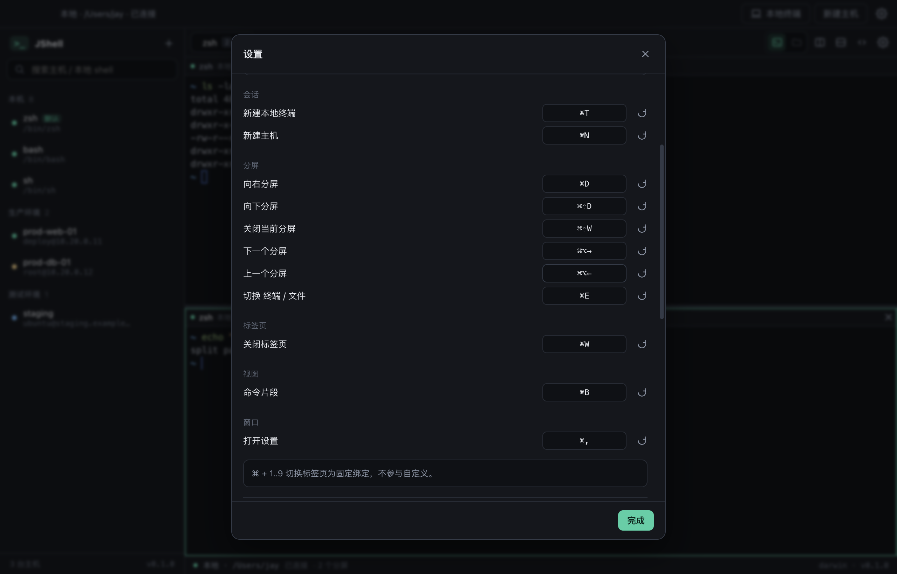

# 架构与数据流

## 1. 分层

```
┌────────────────────────────────────────────────────────────────────────┐
│ Renderer（Chromium / React 18）                                         │
│   App ─ Sidebar / TabBar / PaneTree / TerminalView(xterm.js) / FilesPanel│
│   store(zustand：标签 + 分屏树) ─ terminal-registry（xterm 实例常驻）    │
│   shortcuts（可配置绑定表）── pane-tree（布局树纯函数）                   │
└──────────────────────────────┬─────────────────────────────────────────┘
                               │ window.jshell（contextBridge 白名单）
┌──────────────────────────────┴─────────────────────────────────────────┐
│ Preload（隔离上下文桥）                                                 │
│   仅做参数透传：ipcRenderer.invoke / send / on，不暴露 ipcRenderer 本体  │
└──────────────────────────────┬─────────────────────────────────────────┘
                               │ IPC（invoke/handle + 单向事件 evt:session）
┌──────────────────────────────┴─────────────────────────────────────────┐
│ Main（Node）                                                            │
│   ipc.ts ── SessionManager ─┬─ SshSession   ── ssh2 Client              │
│          │                  │                └ SftpService（同连接复用）│
│          │                  └─ LocalSession ── node-pty（本地 shell）   │
│          ├─ StoreService（state.json / secrets.json + safeStorage）      │
│          ├─ TunnelManager（net.Server ⇄ client.forwardOut）             │
│          └─ clipboard.ts（终端 Cmd+C/V 焦点分流）                        │
└────────────────────────────────────────────────────────────────────────┘
```

三层职责边界清晰：

- **Renderer 不知道传输层是 SSH 还是本地 PTY**，只认 `JShellApi` 的方法与 `SessionEvent`；
- **Preload 不做业务**，只做白名单透传；
- **Main 承担全部系统能力**（网络、进程、文件、加密、对话框），且是唯一持久化写入方。

## 2. 会话模型

SSH 与本地终端对外表现一致，靠一个最小接口统一：

```ts
interface TerminalSession {
  id: string
  kind: 'ssh' | 'local'
  title: string        // 标签标题：prod-web-01 / zsh
  subtitle: string     // deploy@host:22 / 本地 · /Users/jay
  write(data: string): void
  resize(cols: number, rows: number): void
  close(): void
}
```

| 实现 | 文件 | 传输层 | 特有能力 |
| --- | --- | --- | --- |
| `SshSession` | `main/services/ssh-session.ts` | ssh2 Client（shell 通道） | SFTP、端口转发、主机指纹校验 |
| `LocalSession` | `main/services/local-session.ts` | node-pty（`/bin/zsh`、`cmd.exe`…） | 自动探测系统 shell、登录 shell 加载 profile |

`SessionManager.requireSsh()` 会在拿不到 SSH 会话时抛出**可读错误**（"本地终端不支持该操作"），而不是让 SFTP 层蹦出 `undefined is not a function`。

## 3. 本地 shell 探测

`main/services/shells.ts`，结果通过 `app:shells` 一次性给渲染层（侧边栏「本机」分组 + 设置里的下拉）。

| 平台 | 顺序 |
| --- | --- |
| macOS / Linux | `$SHELL` → `/bin/zsh` `/bin/bash` `/usr/bin/fish` `/bin/sh` → `/etc/shells` 中其余合法 shell |
| Windows | `%ComSpec%`（cmd）→ Windows PowerShell → PowerShell 7（pwsh，含 PATH 解析） |

过滤规则：必须真实存在、可执行、basename 在白名单内（zsh/bash/fish/sh/dash/ksh/tcsh/csh/nu/elvish/pwsh），按真实路径去重。启动参数对 Unix shell 使用 `-l`（登录 shell），保证 PATH 与 profile 生效。

## 4. 分屏布局

渲染层用一个**二叉布局树**描述一个标签页内部的划分，纯函数操作集中在 `renderer/src/pane-tree.ts`：

```
type PaneNode =
  | { type: 'leaf';  id: sessionId; pane: PaneState }
  | { type: 'split'; id; direction: 'row' | 'column'; ratio: 0.15~0.85;
      children: [PaneNode, PaneNode] }
```

```
split(row, 0.5)                     ← 左右分屏
├── leaf  (zsh, session A)
└── split(column, 0.4)              ← 在右半边再上下分屏
    ├── leaf (zsh, session B)
    └── leaf (ssh,  session C)
```

关键操作：

| 操作 | 实现 | 说明 |
| --- | --- | --- |
| 分屏 | `replaceLeaf(active, split(leaf, newLeaf))` | 当前叶子被新 split 替换，原叶子成为第一个子节点 |
| 关闭分屏 | `removeLeaf()` | 父节点只剩一个子节点时自动折叠，避免出现单分支 split |
| 拖拽比例 | `setSplitRatio()` | 夹在 0.15~0.85，防止某侧被拖成 0 宽 |
| 循环切换 | `leaves()` 顺序遍历 | 快捷键 `Mod+Alt+←/→` |

**为什么终端要在分屏重排中活下来**：布局树变化会让 React 卸载并重建子树。若 xterm 实例跟着组件销毁，历史输出就没了。因此 `terminal-registry` 把 `Terminal + 宿主 div + FitAddon` 常驻在模块级，组件重新挂载时只是把宿主 div `appendChild` 到新容器（DOM reparent），终端本身不重建；只有会话真正关闭时才 `disposeTerminal()`。

### 4.1 拖拽吸附（docking）

把「标签」或「分屏标题栏」拖到任意分屏的**左/右/上/下边缘**，松手即在该侧并排：

```
拖 3 号标签 ──► 1 号分屏右半边    结果： [1号 | 3号]   （3 号标签消失）
再拖 2 号标签 ─► 新分屏下边缘      结果： [1号 | (3号/2号)]  嵌套分屏
```

- 命中判定：`resolveDockSide()` 取鼠标到四条边的最短距离，拖拽时高亮对应半块区域；
- 落点即语义：`dockTabs()` 用 `insertBeside()` 把目标叶子替换成 `split(目标, 来源)`，
  方向由边决定（左/右 = `row`，上/下 = `column`）；
- 整标签拖入 → 该标签的子树整体并入，原标签移除；单分屏拖入 → 只摘这一片叶子，
  来源标签空了就自动关闭；
- 同标签内拖动即「重新排列」，目标在来源子树内时判定为无效拖拽（避免自引用）。

实现要点：**吸附方向在 drop 时按落点重新计算**，不依赖 dragover 写入的 React state
（同一帧内 dragover→drop 时 state 还没重渲染，会拿到过期值）。

## 5. 快捷键系统



- 绑定表：`renderer/src/shortcuts.ts` 的 `SHORTCUTS` 定义动作 id / 中文名 / 分组 / 默认值；
- 持久化：`settings.keybindings`（`actionId -> "Mod+Shift+D"`，空串表示用默认值）；
- 解析：`Mod` = macOS 的 ⌘ / 其他平台的 Ctrl；`normalizeSpec()` 统一顺序（Mod→Ctrl→Alt→Shift→Key）；
- 匹配：**精确匹配**修饰键，`Mod+D` 不会在按下 `Mod+Shift+D` 时误触发；
- 录制：设置面板里点击按键后监听下一次 keydown，`specFromEvent()` 生成规范串（字母键取物理键位 `e.code`，Shift 状态单独记录）；
- 冲突：同一组合被两个动作占用时，按键胶囊标红提示。

`Mod+1..9` 切标签是固定绑定，不进入自定义表（否则会和用户绑定互相覆盖）。

### 5.1 终端搜索与右键菜单

- 搜索：`@xterm/addon-search`，`Mod+F` 打开搜索条；输入即增量匹配，`onDidChangeResults`
  驱动 `当前/总数` 显示，Enter / ⇧Enter 跳转，关闭时 `clearDecorations()` 清掉高亮。
- 右键菜单由 `TerminalView` 冒泡坐标到 `App`，菜单项全部复用既有能力
  （`term.getSelection / paste / selectAll / clear` + store 的 `splitPane / closeSession`），不新增 IPC。

### 5.2 主机指纹与布局

- 指纹键为 `host:port:算法`（算法从公钥 blob 头部的 wire format 解析），避免同一台机器
  多算法互相覆盖；不匹配时不再只是报错，而是抛 `hostkey` 事件 → 渲染层弹窗对比新旧 SHA256 →
  「信任并重连」写入新指纹。
- 布局持久化只存结构（`kind / hostId / shellPath` + 分割方向与比例），恢复出来的分屏状态是
  `closed`，由用户点「重新连接」再建会话——避免开机瞬间把几十台机器同时连上。

## 6. 数据流

### 6.1 打开 SSH 会话

```
点击主机
  │  renderer: crypto.randomUUID() → 建分屏叶子（status=connecting）
  ▼
jshell.sessions.open(hostId, size, sessionId)
  │  main: SessionManager.openSsh()
  │        ├─ store.getHost / getCredentials（解密口令，仅内存）
  │        ├─ new SshSession(...) 入 Map
  │        └─ void session.connect()  ← 不阻塞返回值
  ▼
client.connect(cfg) ── hostVerifier：TOFU 记录/比对 SHA256 指纹
  ├─ 'ready' → client.shell({term, cols, rows}, {env})
  └─ 事件：status(connecting) → status(ready)
```

**为什么 sessionId 由渲染进程生成**：会话事件是单向推送。若等主进程返回 id 再建 UI，快服务器可能在返回前就推送 `data`，导致输出丢失。先有分屏、再有会话，事件永远不会找不到宿主。

### 6.2 打开本地终端

```
点击「本机 → zsh」
  ▼
jshell.sessions.openLocal(size, sessionId, shellPath?)
  │  main: SessionManager.openLocal()
  │        ├─ shellPath ?? settings.localShell ?? detectShells().defaultShell
  │        ├─ 路径存在性校验（存在绝对路径时）
  │        └─ new LocalSession().start()
  ▼
pty.spawn(shell, ['-l'], { name:'xterm-256color', cols, rows, cwd: homedir(),
                           env: {TERM, COLORTERM, LANG, ...process.env} })
  ├─ proc.onData → OutputBuffer → evt:session(data)
  ├─ proc.onExit → status(closed, `进程已退出（code N）`)
  └─ status(ready)
```

### 6.3 终端输入 / 输出

```
键盘 → xterm.onData → jshell.sessions.write(sessionId, data) → stream.write / proc.write
远端/本地输出 → StringDecoder / pty string
  → OutputBuffer：≥64KB 或 8ms 到点才 flush（一次 IPC 承载多包）
  → evt:session{type:'data'} → store.handleEvent（不进 React state）
  → terminal-registry.pushTerminalData → term.write()
```

### 6.4 文件传输

```
下载：FilesPanel 双击文件 → sftp.download(sessionId, remotePath)
      → dialog.showSaveDialog → sftp.createReadStream ⇄ fs.createWriteStream
      → 每 120ms 推 evt:session{type:'transfer'} → 状态栏进度条
上传：sftp.upload(sessionId, cwd) → dialog 多选 → 逐个 pipe
```

SFTP 通道按会话懒加载并复用（`SshSession.sftp()` 缓存 Promise），文件面板与终端共享同一条 SSH 连接。

### 6.5 配置持久化

```
写：renderer → IPC → StoreService.upsertHost / updateSettings
      → 内存 state 更新 → writeJsonAtomic(state.json)（tmp + rename）
      → 口令 seal() 后写 secrets.json
读：启动时同步读取（几十 KB），renderer bootstrap 一次性拉全量
```

## 7. IPC 契约

通道集中在 `src/shared/ipc.ts`，签名集中在 `src/shared/api.ts`（`JShellApi`），三端共用。

| 通道 | 方向 | 参数 | 返回 |
| --- | --- | --- | --- |
| `host:list` / `host:save` / `host:remove` | invoke | — / `HostDraft` / `id` | `HostProfile[]` / `HostProfile` / `void` |
| `session:open` | invoke | `hostId, {cols,rows}, sessionId` | `OpenSessionResult` |
| `session:open-local` | invoke | `{cols,rows}, sessionId, shellPath?` | `OpenSessionResult` |
| `session:write` / `session:resize` / `session:close` | invoke | `sessionId, …` | `void` |
| `sftp:list` / `sftp:home` / `sftp:mkdir` / `sftp:rename` / `sftp:remove` | invoke | `sessionId, path…` | `FileEntry[]` / `string` / `void` |
| `sftp:download` / `sftp:upload` | invoke | `sessionId, path` | `{canceled, path/count}` |
| `sftp:upload-dir` / `sftp:download-to` / `transfer:cancel` | invoke | `sessionId, …` / `taskId` | `{canceled, count}` / `{count}` / `void` |
| `local:home/list/mkdir/rename/remove` | invoke | `path…` | `string` / `FileEntry[]` / `void` |
| `local:reveal` | renderer → main | `path` | — |
| `config:export` / `config:import` | invoke | — | `{canceled, path?}` / `{canceled, hosts?, snippets?}` |
| `settings:get` / `settings:update` | invoke | — / `Partial<AppSettings>` | `AppSettings` |
| `snippet:*` | invoke | — | `Snippet` / `void` |
| `tunnel:start` / `tunnel:stop` / `tunnel:list` | invoke | — | `TunnelRuntimeInfo` / `void` |
| `host:test` | invoke | `HostDraft` | `ConnectionTestResult` |
| `rsync:check` / `rsync:probe` | invoke | — / `hostId` | `RsyncCapability` / `RsyncProbeResult` |
| `rsync:start` / `rsync:cancel` | invoke | `RsyncPlan` / `taskId` | `RsyncTask` / `void` |
| `evt:rsync` | main → renderer | `RsyncTask` | — |
| `sftp:read-text` / `sftp:write-text` | invoke | `sessionId, path[, text]` | `TextFile` / `void` |
| `local:read-text` / `local:write-text` | invoke | `path[, text]` | `TextFile` / `void` |
| `app:info` / `app:shells` / `app:release-info` | invoke | — | `AppInfo` / `ShellsResult` / `ReleaseInfo` |
| `app:open-logs` / `app:open-path` / `app:open-doc` / `app:open-external` | invoke | `path` / `name` / `url` | `void` |
| `update:check` | invoke | — | `UpdateCheckResult` |
| `host:trust-key` | invoke | `host, port, algorithm, fingerprint` | `void` |
| `layout:get` / `layout:save` | invoke | — / `PersistedTab[]` | `PersistedTab[]` / `void` |
| `dialog:pick-file` / `dialog:confirm` | invoke | — | `string \| string[] \| null` / `boolean` |
| `term:focus` | renderer → main | `boolean` | — |
| `clip:command` | main → renderer | `{action:'copy'\|'paste', text?}` | — |
| `evt:session` / `evt:app-command` | main → renderer | `SessionEvent` / `AppCommand` | — |

`SessionEvent` 五种形态：`status`、`data`、`transfer`、`tunnel`、`hostkey`。

## 8. 错误处理

| 层 | 策略 |
| --- | --- |
| ssh2 / SFTP / 系统错误 | `shared/errors.ts` 统一映射为中文（认证 / 指纹 / 权限 / 路径 / 网络）；未命中返回中文兜底，原文只进日志 |
| 本地 shell 启动失败 | 捕获 `pty.spawn` 异常，提示「无法启动本地 shell（路径）：原因」，并在分屏内提供重连按钮 |
| 进程退出 | `proc.onExit` 转成 `status(closed, "进程已退出（code N）")`，标签保留最后输出 |
| IPC handler | 统一 `try/catch`，Error → `throw new Error(message)`，渲染层可 catch |
| 传输失败 | 删除本地半成品、任务标红、Toast 提示 |
| 配置损坏 | 读取失败回退空配置（不覆盖原文件） |

## 9. 关键设计决策

| 决策 | 原因 |
| --- | --- |
| 会话接口统一 SSH / 本地 | 渲染层无需区分传输层；新增传输（如 telnet、串口）只需实现该接口 |
| 终端实例常驻 + DOM reparent | 分屏重排会重建组件树，实例常驻才能保住滚动历史 |
| sessionId 由渲染进程生成 | 消除「事件早于 UI 创建」的竞态 |
| 输出 8ms / 64KB 聚合 | 大输出时 IPC 次数降 1~2 个数量级，帧率稳定 |
| 分屏用二叉布局树 | 支持任意嵌套，增删/折叠/拖拽都是纯函数，易测试 |
| 自研 JSON 存储 | `electron-store@10` 为 ESM-only，与主进程 CJS 冲突；自写 200 行可控原子写入与加密字段 |
| node-pty 用 N-API 预编译 | 不触发 electron-rebuild；`.node`/`spawn-helper` 走 `asarUnpack`，postinstall 兜底权限 |
| Cmd+C/V 焦点分流 | 菜单 copy role 会抢走 Cmd+C 导致 xterm 选区复制失效；终端聚焦时由主进程拦截再回投，输入框仍走系统编辑命令 |
| 口令单向入参 | `JShellApi` 没有「读取密码」的方法，渲染层被 XSS 也拿不到已存口令 |
| 吸附方向按落点算 | dragover 与 drop 可能同帧，依赖 state 会拿到过期的 null |
| 传输写临时文件 | 失败时只删 `.part`，覆盖已有文件也不会被截断 |
| 布局只存结构不存运行态 | 恢复后需手动重连，避免启动瞬间并发连几十台机器 |

## 10. 扩展点

### 本地文件面板
已实现：`services/local-fs.ts` 提供列目录 / 新建 / 重命名 / 回收站删除 / 系统定位，`LocalFilesPanel` 复用同一套 `FileEntry` 结构；本地终端标题栏可直接切换。

### 端口转发
后端已实现 `local`（`-L`）：`tunnel.start()` 起 `net.Server`，每个连接 `client.forwardOut()` 桥接。补 UI 只需在标签页加面板；`remote`/`dynamic` 分别在 `client.forwardIn()` 与 SOCKS 层实现。

### rsync 同步
已实现：`services/rsync.ts` 负责参数拼装（含 2.6.9 / 3.x 差异与旧版降级）、进度行解析与失败重试，`RsyncWizard.tsx` 提供三步向导（本机上传 / 下载 / 服务器间中转）。

### 终端搜索 / 会话录制
搜索已实现（`@xterm/addon-search` + `TerminalSearchBar`，`⌘/Ctrl+F`，带 `当前/总数`）。会话录制仍未实现：所有输出都经过 `terminal-registry.pushTerminalData` 单一入口，在此旁路写 asciinema cast 即可。

### 布局持久化
`TerminalTab.root` 已是可序列化的纯数据（叶子存 hostId / shellPath），写入 `state.json` 后重启即可恢复分屏结构。

## 11. 平台层（macOS / Windows 一致性的落点）

```
main/index.ts                 窗口、托盘、系统菜单、关闭行为、启动隐藏
  ├─ services/app-env.ts      便携版判定 → app.setPath('userData' / 'sessionData')
  ├─ services/tray.ts         Template Image( macOS ) / .ico( Windows ) + 中文菜单
  ├─ services/notifications.ts焦点判断 + 8s 去重（会话异常 / 传输失败）
  ├─ services/login-item.ts   开机自启（登录项 / 启动项 + --hidden）
  ├─ services/logger.ts       本地中文日志 + 进程级异常兜底
  └─ services/update.ts       更新 Provider（内部渠道 disabled，零请求）
shared/paths.ts               ~ / %VAR% / 分隔符归一（纯函数，有单测）
```

关键约定：

1. **数据目录只有一个来源**：`app.getPath('userData')`，便携版在 ready 之前覆盖；
   业务代码不拼 `~/Library` 或 `%APPDATA%`。
2. **平台差异只出现在三个文件**：`app-env.ts`（目录）、`tray.ts`（图标形态）、`login-item.ts`（登记方式），
   其余模块不判断 `process.platform`。
3. **托盘命令与应用内操作同源**：主进程只发 `AppCommand`（`evt:app-command`），
   渲染层用与快捷键相同的 store 动作执行，避免两套逻辑。
4. **关闭 ≠ 退出**：`close` 事件在 `closeToTray` 开启时 `preventDefault()` + `hide()`；
   只有托盘「退出」或系统退出才设置 `quitting` 并真正结束会话。
5. **通知不打扰**：窗口聚焦时不发；同一内容 8 秒内只发一次；用户可完全关闭。

## 12. 分发扩展点

| 能力 | 现状 | 启用方式 |
| --- | --- | --- |
| 代码签名（macOS） | 未签名 | 配置 `CSC_LINK` / `CSC_KEY_PASSWORD` |
| 公证（macOS） | 跳过 | 配置 `APPLE_ID` / `APPLE_APP_SPECIFIC_PASSWORD` / `APPLE_TEAM_ID`，`build/notarize.cjs` 自动执行 |
| 代码签名（Windows） | 未签名 | 配置 `CSC_LINK` / `CSC_KEY_PASSWORD` |
| 更新检查 | 内部渠道关闭 | `JSHELL_CHANNEL=public` + `JSHELL_UPDATE_URL=https://...` 重新构建 |
| 许可 / 隐私 | 已随包分发 | 替换 `docs/license.md` / `docs/privacy.md` 内容即可 |

`build/release-meta.json` 是唯一的构建期注入点：版本、渠道、更新地址、构建时间都在这里，
运行时由 `services/update.ts` 读取，渲染层只消费结果，不需要为「是否公开」写分支。
